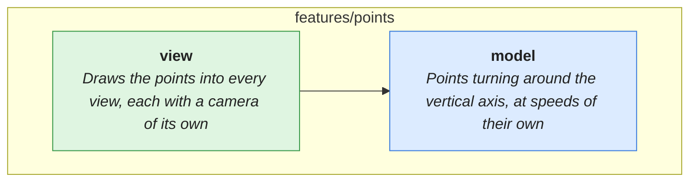

# features/points

> Turning points, drawn into views on two canvases.

<!-- architecture:start -->
Arrows point from a layer to what it uses. The boxes below are other features this one uses; one that another of its uses already brings in is left out.

| | What |
|---|---|
| [model](model/README.md) | Points turning around the vertical axis, at speeds of their own |
| [view](view/README.md) | Draws the points into every view, each with a camera of its own |
<!-- architecture:end -->
