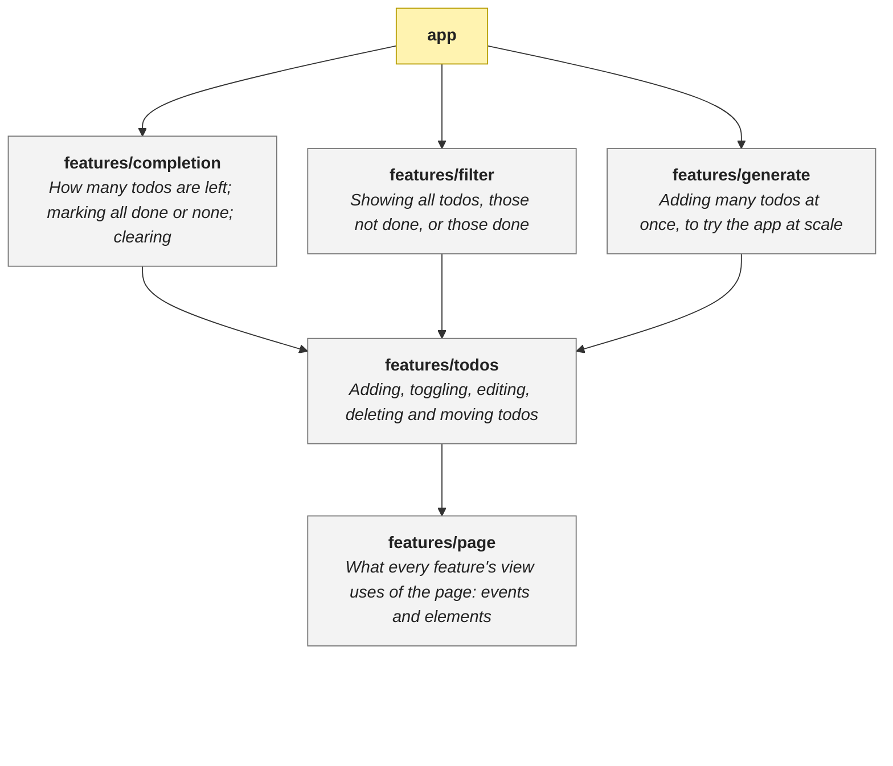

# Architecture

> The features of the app and what uses what; start here and follow the links down.

<!-- architecture:start -->
Arrows point from what uses to what is used, so the most core features are at the bottom. An arrow a longer path already implies is left out. Each feature links to its own document or, when it has one layer, to that layer's README. Yellow is an app, which puts features together.

| | What |
|---|---|
| [features/completion](features/completion/ARCHITECTURE.md) | How many todos are left; marking all done or none; clearing |
| [features/filter](features/filter/ARCHITECTURE.md) | Showing all todos, those not done, or those done |
| [features/generate](features/generate/ARCHITECTURE.md) | Adding many todos at once, to try the app at scale |
| [features/page](features/page/view/README.md) | What every feature's view uses of the page: events and elements |
| [features/todos](features/todos/ARCHITECTURE.md) | Adding, toggling, editing, deleting and moving todos |
<!-- architecture:end -->
