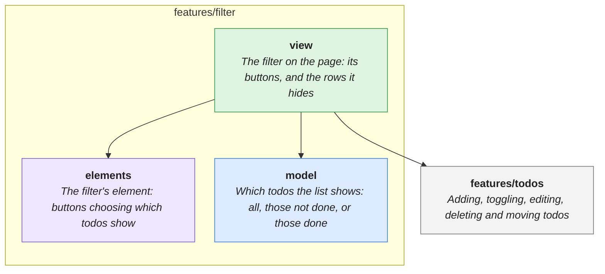

# features/filter

> Showing all todos, those not done, or those done.

<!-- architecture:start -->
Arrows point from a layer to what it uses. The boxes below are other features this one uses; one that another of its uses already brings in is left out.

| | What |
|---|---|
| [elements](elements/README.md) | The filter's element: buttons choosing which todos show |
| [model](model/README.md) | Which todos the list shows: all, those not done, or those done |
| [view](view/README.md) | The filter on the page: its buttons, and the rows it hides |
<!-- architecture:end -->
