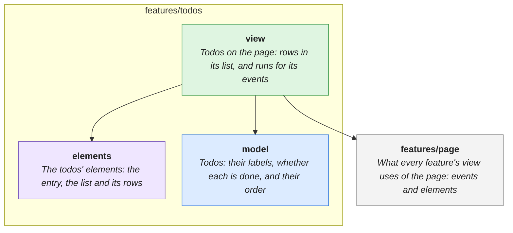

# features/todos

> Adding, toggling, editing, deleting and moving todos.

<!-- architecture:start -->
Arrows point from a layer to what it uses. The boxes below are other features this one uses; one that another of its uses already brings in is left out.

| | What |
|---|---|
| [elements](elements/README.md) | The todos' elements: the entry, the list and its rows |
| [model](model/README.md) | Todos: their labels, whether each is done, and their order |
| [view](view/README.md) | Todos on the page: rows in its list, and runs for its events |
<!-- architecture:end -->
