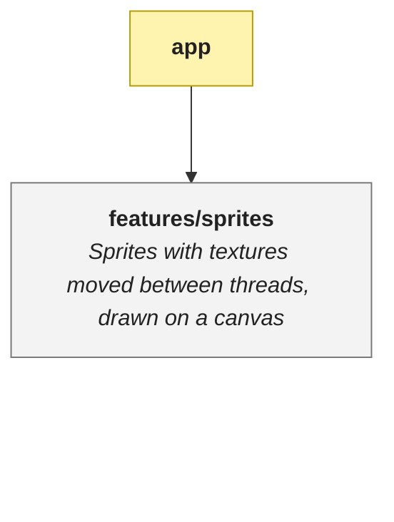

# Architecture

> The features of the app and what uses what; start here and follow the links down.

<!-- architecture:start -->
Arrows point from what uses to what is used, so the most core features are at the bottom. An arrow a longer path already implies is left out. Each feature links to its own document or, when it has one layer, to that layer's README. Yellow is an app, which puts features together.

| | What |
|---|---|
| [features/sprites](features/sprites/ARCHITECTURE.md) | Sprites with textures moved between threads, drawn on a canvas |
<!-- architecture:end -->
