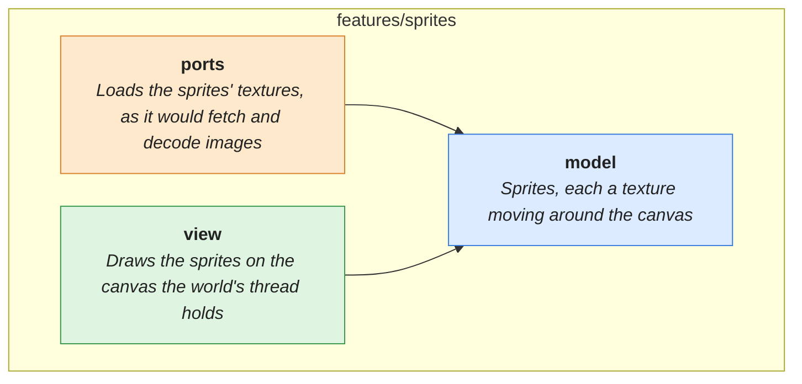

# features/sprites

> Sprites with textures moved between threads, drawn on a canvas.

<!-- architecture:start -->
Arrows point from a layer to what it uses. The boxes below are other features this one uses; one that another of its uses already brings in is left out.

| | What |
|---|---|
| [model](model/README.md) | Sprites, each a texture moving around the canvas |
| [ports](ports/README.md) | Loads the sprites' textures, as it would fetch and decode images |
| [view](view/README.md) | Draws the sprites on the canvas the world's thread holds |
<!-- architecture:end -->
